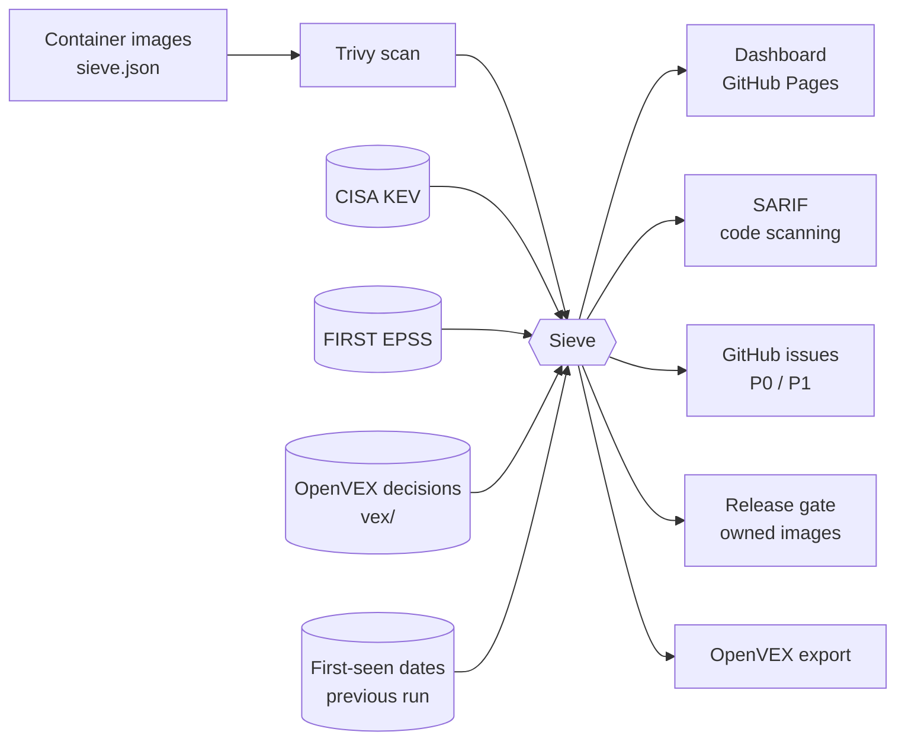

# Sieve: vulnerability triage that tells you what to fix first

[](https://github.com/ahmedelgmal310/sieve/actions/workflows/ci.yml)
[](https://github.com/ahmedelgmal310/sieve/actions/workflows/triage.yml)
[](LICENSE)

**Live dashboard: [ahmedelgmal310.github.io/sieve](https://ahmedelgmal310.github.io/sieve/)**

A container scanner reports thousands of CVEs, and teams either drown in them or stop looking. Sieve turns the scanner's output into a short, ordered list of work. It answers three questions for every finding:

1. **Does it affect us at all?** It applies OpenVEX decisions and reviewed not-affected rules.
2. **Is anyone exploiting it?** It checks the CISA Known Exploited Vulnerabilities catalogue and FIRST's EPSS probability of exploitation.
3. **How soon must it be fixed?** It assigns a priority with a remediation deadline (SLA) measured from the day the finding was first seen.

On the first daily run across seven images, Trivy reported **21,864** findings. Sieve narrowed them to **103 urgent findings: 32 distinct vulnerabilities**, a 99.5% reduction, and explained each decision:

- **18,347** were in `linux-libc-dev`. That package only holds kernel headers, and a container runs the host's kernel, so a reviewed rule marks them not affected and records why in the OpenVEX export.
- Of the 3,517 that do affect the images, **1,764** have a fix or an exploitation signal, and **32 vulnerabilities** are urgent: actively exploited (CISA KEV) or likely to be (EPSS).
- The two images I own ship with **zero** vulnerabilities, so the release gate passes; the five third-party images are monitored.
- Sieve opened one GitHub issue per urgent vulnerability (capped per run) and uploaded them to code scanning.

## How it works



The [daily workflow](.github/workflows/triage.yml) scans every image, downloads that day's KEV and EPSS data, triages, and publishes. It runs every day even when nothing changed, because the risk of an unchanged image changes daily: new CVEs are published, EPSS scores move, and CISA adds newly exploited vulnerabilities.

## Priorities

| Priority | When | Fix within |
|---|---|---|
| **P0** | In CISA KEV (exploited in the wild), or EPSS ≥ 50% | 2 days |
| **P1** | High/critical with EPSS ≥ 10%, or critical on an internet-facing image | 7 days |
| **P2** | High/critical with a fix and no exploitation signal | 30 days |
| **P3** | Anything else that has a fix | 90 days |
| watch | No fix released and no sign of exploitation; re-checked every run | none |
| suppressed | Covered by an OpenVEX `not_affected` / `fixed` decision or a reviewed rule | none |

Thresholds and SLAs live in [`sieve.json`](sieve.json). Every priority comes with a reason a developer can act on, for example *"Actively exploited in the wild (CISA KEV since 2023-11-21)"* or *"73% probability of exploitation in the next 30 days (EPSS)"*.

## What it produces

- **Dashboard** (GitHub Pages): the noise funnel, the work list with filters, per-image breakdown and the policy
- **GitHub issues:** one per urgent vulnerability across all images. Sieve opens it, keeps it updated, and closes it with a note when the fix lands. A per-run cap stops a first scan from flooding the backlog, and Sieve only ever touches issues carrying its own label.
- **SARIF** for GitHub code scanning, with KEV-listed findings raised to critical
- **OpenVEX export** of every suppression, so an auditor can see what was set aside and why
- **Release gate:** owned images (`"gate": true`) fail the run on a P0 or an overdue finding. Third-party images are monitored, not gated.
- **Job summary** in Markdown, plus `results.json` for other tools

## Saying "not affected", properly

Do not close an issue by hand. Record the decision in an OpenVEX document under [`vex/`](vex):

```json
{
  "@context": "https://openvex.dev/ns/v0.2.0",
  "author": "Ahmed Elgammal",
  "timestamp": "2026-10-26T00:00:00Z",
  "statements": [{
    "vulnerability": { "name": "CVE-2024-0007" },
    "products": [{ "@id": "web" }],
    "status": "not_affected",
    "justification": "vulnerable_code_not_in_execute_path"
  }]
}
```

The document is reviewed like code. CI rejects it without a valid justification or an author, and a later `affected` statement overrides an earlier `not_affected` one.

## Engineering

- **Go, standard library only:** no third-party dependencies, so the tool that judges other people's supply chain has none of its own (CI enforces it)
- **Tests:** 94% coverage with the race detector and an 85% gate; golangci-lint with gosec; govulncheck; Gitleaks on the full history; actionlint
- **Pipelines:** actions pinned to commit SHAs, tool images pinned to digests, least-privilege tokens per job

## Run it locally

```bash
trivy image --format json --output reports/nginx.json nginx:1.25.3
go run ./cmd/sieve triage -config sieve.json -reports reports -out out
open out/index.html
```

`go run ./cmd/sieve check` validates `sieve.json` and every VEX document without scanning anything.

## License

[MIT](LICENSE)
